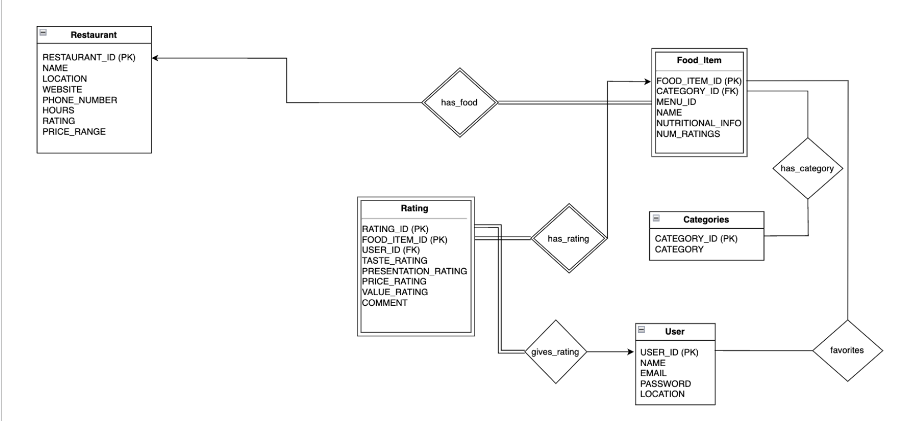

# DishScout

DishScout is a Flask prototype for finding NYC restaurants by name or dish, reading dish reviews, and saving favorites. It combines a PostgreSQL data model with restaurant details from Google Places and menu items collected from MenuPages.

> **Project status:** The original Google Cloud backend is down. To run DishScout, set up your own PostgreSQL database and add your own restaurant and dish data.

## What it demonstrates

- Restaurant and dish search with rating ordered results
- Dish detail pages with categories and ratings for taste, presentation, price, and value
- Account signup and login with hashed passwords
- Review creation and editing, plus saved favorites and a profile page
- Data collection using Google Places and BeautifulSoup

## Stack

Python, Flask, Jinja2, SQLAlchemy, PostgreSQL, Bootstrap, BeautifulSoup, and Google Places API.

## Database design



Core tables include `users`, `restaurant`, `food_item`, `rating`, `favorites`, `has_category`, and `categories`. The [project overview](https://docs.google.com/document/d/1cEgapEnk3fTTAv82EnQzZRzjht9IdKRuFRdzxVCsBmw/edit?usp=sharing) describes the original design. This repository contains the schema image but no SQL migrations or seed files.

## Running locally

1. Clone the repository and create a Python virtual environment.
2. Install the packages in `requirements.txt`.
3. Create a PostgreSQL database with the tables and sample data expected by `server.py`.
4. Copy `.env.example` to `.env` and set `DATABASE_URL` and `SECRET_KEY`. Keep `.env` out of Git.
5. Run `python server.py` and open `http://localhost:8111`.

```bash
git clone https://github.com/hibaa8/DishScout.git
cd DishScout
python3 -m venv .venv
source .venv/bin/activate
pip install -r requirements.txt
cp .env.example .env
python server.py
```

`DATABASE_URL` should be a SQLAlchemy PostgreSQL connection URL. `GOOGLE_PLACES_KEY` is needed only for the optional `add_data.py` import script, which also depends on MenuPages and a populated database.

